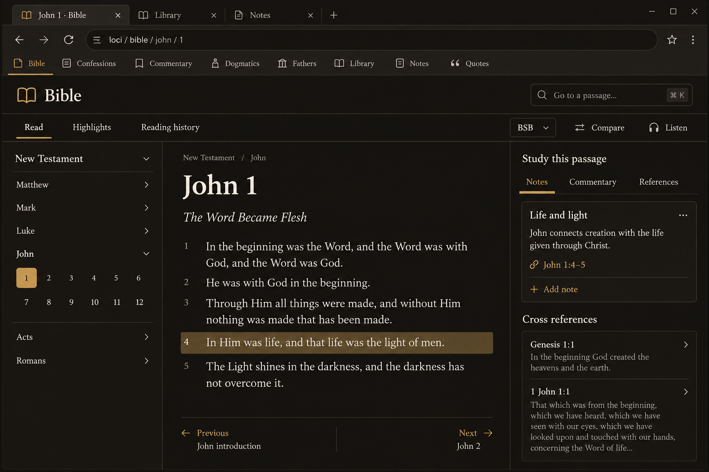
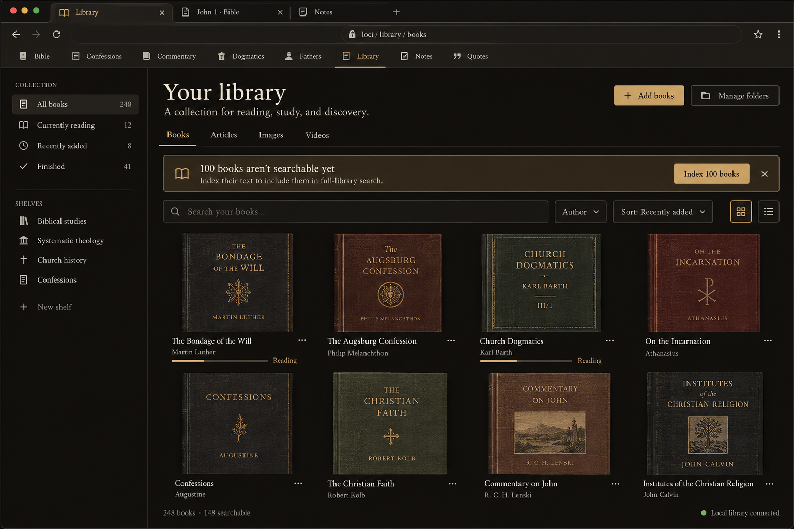
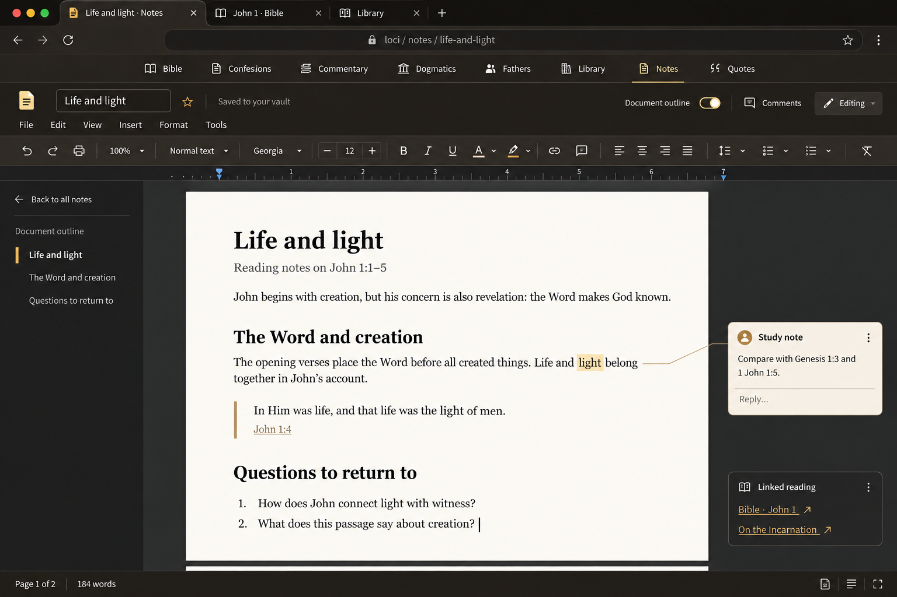

# Loci page design concepts

Visual proposals for individual pages inside Loci's browser frame. These images illustrate design directions; they do not represent implemented functionality.

## Bible

A reading page with contents navigation, generous text spacing, and an optional study sidebar. The same reading layout can guide Confessions, Commentary, Dogmatics, and Fathers.

## Library

A collection page with shelves, filters, cover thumbnails, and a visible prompt to index books that are not yet searchable.

## Notes editor

The requested Google Docs-style editing surface: a light document page inside the dark Loci frame, with a formatting toolbar, ruler, outline, and comments margin. Notes browsing can remain a separate collection page.

Features illustrated here, including pagination and comments, would require implementation.

